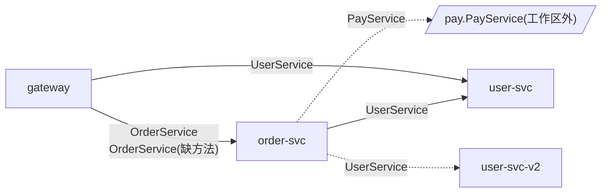

# kitex-depgraph

Kitex 微服务**跨仓库静态依赖分析**原型：从一个功能点出发，追出它涉及哪些仓库，以及仓库之间通过哪些 RPC 接口调用。

- **不编译、不运行、不下载依赖**:直接读源码，拿到代码就能扫，不需要能 `go build`。
- **两种生成方式都支持**:Kitex 生成代码放在各业务仓库里(本仓生成)，或集中放在公共 IDL 仓库里(公共仓生成)，也可以两种混用。
- **零外部依赖**:只用 Go 标准库，Go 1.21 及以上版本可直接编译。

> 这是原型(v0.1),用来验证方案可行性。方案的完整调研见 [docs/design.md](docs/design.md)。

## 能回答哪些问题

| 问题 | 命令 |
|---|---|
| 一个功能点(HTTP 入口或 RPC 方法)涉及哪些仓库，依次调用了哪些 RPC? | `trace` |
| 某个 RPC 方法被哪些仓库的哪些函数调用? | `callers` |
| 这次改动(git diff)会影响哪些上游仓库、哪些接口和入口?(适合接入代码评审) | `impact` |
| 全局服务依赖图是什么样?IDL 有没有不同步?有没有调用到实现方已经没有的方法? | `scan` 生成的 `report.md` |

下面的示例来自仓库自带的演示工作区 [`testdata/demo`](testdata/demo):一个网关、两个后端服务、一个公共 IDL 仓库和一个共享 SDK,里面故意埋了几处问题。

**服务依赖图**(`scan` 生成，GitHub 会直接渲染):



**一个功能点的跨仓调用链**(`trace gateway:CreateOrder`):

```text
[gateway] handler.CreateOrder  handler/order.go:11
└─ rpc.CreateOrder  rpc/order.go:16
   └─ ⇒ RPC order.OrderService/CreateOrder  gateway:rpc/order.go:17
      └─ [order-svc] (*handler.OrderServiceImpl).CreateOrder  handler/handler.go:19
         └─ (*service.OrderService).Create  service/order.go:30
            ├─ ⇒ RPC user.UserService/GetUser  order-svc:service/order.go:31
            │  └─ [user-svc] (*main.UserServiceImpl).GetUser  handler.go:14
            └─ (rpc.PayAdapter).Prepay (接口调用)  rpc/pay.go:21
               └─ ⇒ RPC pay.PayService/prepay  order-svc:rpc/pay.go:22  [工作区外]
                  └─ ⊘ pay.PayService(工作区外的服务)

涉及组件(3):gateway → order-svc → user-svc
RPC 调用(3):
  gateway → order.OrderService/CreateOrder → order-svc
  order-svc → user.UserService/GetUser → user-svc
  order-svc → pay.PayService/prepay → 工作区外
```

**一次改动的跨仓影响面**(`impact`,改的是 user-svc 里的一个内部函数):

```text
改动的函数(1):
  service.LoadUser  service/user.go:10

受影响的 RPC 接口(4):
  user.UserService/GetUser  实现:[user-svc] (*main.UserServiceImpl).GetUser
    ← [gateway] rpc.GetUserName  rpc/user.go:14
    ← [order-svc] (*service.OrderService).Create  service/order.go:31
    ← [gateway] (*usersdk.Client).DisplayName  common-sdk:usersdk/client.go:21
    ……
  order.OrderService/CreateOrder(传递影响，第 2 层)  实现:[order-svc] (*handler.OrderServiceImpl).CreateOrder
    ← [gateway] rpc.CreateOrder  rpc/order.go:17

受影响的入口(路由/回调处理函数，或没有调用方的函数，4):
  [gateway] handler.CreateOrder  handler/order.go:11
  [gateway] handler.GetOrderDetail  handler/order.go:20
  ……
需要知会/回归的组件:gateway、order-svc、user-svc
```

完整输出见 [`examples/demo`](examples/demo)。用真实开源项目 CloudWeGo gomall(10 个仓库)跑出的结果见 [`examples/gomall`](examples/gomall)。

## 快速开始

### 1. 编译

需要 Go 1.21 或更高版本。仓库是私有的，克隆后本地编译最简单:

```bash
git clone https://github.com/Dut-YangLiu/kitex-depgraph.git
cd kitex-depgraph
go build -o kitex-depgraph ./cmd/kitex-depgraph
./kitex-depgraph version
```

先用自带的演示工作区试一下:

```bash
./kitex-depgraph scan -c testdata/demo/workspace.json
./kitex-depgraph trace gateway:CreateOrder
```

### 2. 写工作区配置

把要分析的仓库列在一个 JSON 文件里，路径相对这个文件:

```json
{
  "name": "trade",
  "repos": [
    {"name": "gateway",   "path": "../gateway"},
    {"name": "order-svc", "path": "../order-svc"},
    {"name": "user-svc",  "path": "../user-svc", "serviceNames": ["user"]},
    {"name": "idl",       "path": "../idl"}
  ]
}
```

公共 IDL 仓库建议也列进来。不列的话，工具会去 `vendor/` 和 Go 模块缓存(`GOMODCACHE`)里找 `kitex_gen`;都找不到时会给出警告，经由这些包的调用就识别不到了。

也可以不写配置，直接列目录，每个目录当作一个仓库:`kitex-depgraph scan ../gateway ../order-svc ../idl`。

| 字段 | 说明 |
|---|---|
| `repos[].name` / `path` | 仓库名(报告里显示的名字)和目录 |
| `repos[].serviceNames` | 可选。这个仓库的服务注册名(调用方 `NewClient` 传的 destService)。代码里用 `server.WithServerBasicInfo` 写了常量就不用填;注册名来自配置文件或环境变量时填上，能消除"多个候选实现方"的歧义 |
| `repos[].singleComponent` | 可选。仓库里有多个 main 包时，默认按 main 包拆成多个组件;设为 `true` 则整个仓库算一个组件 |
| `genDirNames` | 可选。生成代码目录名，默认 `["kitex_gen"]` |
| `firstPartyPrefixes` | 可选。公司内部模块前缀，如 `["code.example.com/"]`,这些包在模块缓存里时也会读源码 |
| `includeTests` | 可选。同时分析 `_test.go` |
| `skipDirs` | 可选。额外跳过的目录名 |

### 3. 扫描

```bash
./kitex-depgraph scan -c workspace.json        # 输出到 depgraph-out/
```

生成两个文件:

- `depgraph-out/graph.json`:全部事实数据(服务、实现、客户端、调用点、调用图、问题)，后面的查询命令都只读它，也方便其他工具或评审 skill 消费;
- `depgraph-out/report.md`:报告，包含服务依赖图(Mermaid)、跨服务调用明细、服务实现、生成代码副本和问题清单。

### 4. 查询

```bash
# 一个功能点涉及哪些仓库:起点可以是函数名片段、"仓库名:函数名"，或 rpc:服务/方法
./kitex-depgraph trace CreateOrder
./kitex-depgraph trace gateway:CreateOrder -format mermaid      # 输出流程图，按仓库分组
./kitex-depgraph trace rpc:order.OrderService/CreateOrder       # 从 RPC 方法的实现开始

# 谁在调用这个接口
./kitex-depgraph callers user.UserService/GetUser

# 改动的跨仓影响面
git diff -U0 origin/main...HEAD | ./kitex-depgraph impact -repo user-svc -diff -
./kitex-depgraph impact -repo user-svc -files service/user.go
./kitex-depgraph impact -repo idl -files kitex_gen/user/userservice/client.go   # IDL 改动
```

`trace` 默认只显示通向 RPC 调用的路径，加 `-full` 显示全部分支。`callers`、`trace`、`impact` 都支持 JSON 输出(`-json` 或 `-format json`)。

## 工作原理

### 1. 识别 Kitex 生成代码里的锚点

不管哪个 Kitex 版本，生成的服务包里都有这些稳定的内容(已在 CloudWeGo 示例仓库里 Kitex v0.1.4 到 v0.16.1 共 13 个版本的生成代码上验证):

| 位置 | 锚点 | 用途 |
|---|---|---|
| 文件头 | `// Code generated by Kitex vX.Y.Z. DO NOT EDIT.` | 判定是生成代码，记录生成器版本 |
| serviceInfo | `serviceName := "UserService"`,`Extra` 里的 `"PackageName": "user"` | IDL 身份 `user.UserService` |
| kClient 方法 | `p.c.Call(ctx, "getUser", ...)` | Go 方法名到线上方法名的映射(两者大小写可能不同) |
| client.go | `type Client interface`、`NewClient(destService, ...)` | 调用侧入口 |
| server.go | `NewServer(handler, ...)`、`RegisterService(svr, handler, ...)` | 实现侧入口 |

### 2. 跨仓对齐

- **主键(IDL 身份)**:`PackageName.ServiceName/线上方法名`。调用方和实现方各自从**自己引用的那份生成代码**里读出，所以不管生成代码在本仓还是公共仓，都能对上。两边引用同一个生成包时(公共仓)，报告里标为"共享生成代码"。
- **辅键(服务注册名)**:调用方 `NewClient` 的 destService,对应实现方 `WithServerBasicInfo` 注册的 ServiceName(或配置里的 `serviceNames`)。同一个 IDL 有多个实现方时，用它选出真正被调用的那个。

destService 的取值会尽量静态求出：常量(跨包也可以)、用字面量初始化的包级变量、经由结构体字段或工厂函数传递的客户端都能追到;来自配置的值标记为"动态"。

### 3. 不依赖构建环境

用标准库 `go/types` 对工作区源码做类型检查，但不走 `go list`,也不需要下载依赖:

- 工作区内的包、`kitex_gen` 生成代码(包括 vendor 和模块缓存里的)、`firstPartyPrefixes` 指定的模块：读源码;
- 其余所有导入(标准库、Kitex 框架、第三方库)：换成空的占位包。

依赖占位包的表达式只会得到"无效类型"，不影响分析需要的东西：生成的 `Client` 类型、工作区内的函数、结构体字段、常量都来自读了源码的包。所以 `scan -v` 里看到大量类型检查错误是正常的。

### 4. 仓内调用图

- 静态调用：函数调用、具体类型的方法调用;
- 接口调用：用类层次分析(CHA)展开到仓库内的实现，在参数类型可知时比较签名，减少误连;
- 函数引用：把函数当值传递(注册路由、回调)也算一条边，所以 Hertz、Gin 一类框架注册的 handler 能被串起来;
- RPC 调用：对生成的 `Client` 接口的方法调用，经跨仓对齐跳到实现方仓库的实现函数，继续展开。

### 5. 组件与共享库

一个仓库通常就是一个组件(部署单元)。仓库里有多个 main 包时按 main 包拆分。没有 main 包的代码(SDK、公共模块)算"库"，库里发生的 RPC 调用会沿调用图归属到实际调用它的服务组件上;没有服务用到的库代码不会出现在依赖图里。

## 问题类型

| 类型 | 级别 | 含义 |
|---|---|---|
| `missing-method` | 高 | 调用方调用的方法，在实现方的生成代码里不存在：IDL 版本不一致，线上会报方法不存在 |
| `drift` | 中 | 同一个 IDL 服务的几份生成代码方法集合不一致(IDL 不同步) |
| `ambiguous` | 中 | 同一个 IDL 有多个实现方，又无法用 destService 区分 |
| `name-mismatch` | 中 | destService 与实现方注册的服务名对不上 |
| `handler-unresolved` | 中 | 找不到注册的 handler 的具体类型，无法定位方法实现 |
| `external` | 提示 | 调用的服务在工作区里没有实现方(把对应仓库加进来即可) |
| `dynamic-dest` | 提示 | destService 来自运行时，只按 IDL 身份匹配 |
| `no-caller` | 提示 | 提供的服务在工作区里没有调用方 |

## 接入代码评审

`impact` 的 JSON 输出适合在评审流程里使用(包括 Claude Code 的评审 skill):

```bash
git diff -U0 origin/main...HEAD | kitex-depgraph impact -g depgraph-out/graph.json -repo <仓库名> -diff - -json
```

关键字段:`changed`(改动的函数)、`affectedRPCs`(受影响的 RPC 接口，每个带 `callers` 调用点和 `level` 传递层级)、`idlChanges`(生成代码改动及其全部调用方)、`entries`(受影响的入口函数)、`components`(需要知会或回归的组件)。

建议流程：每天或每次合入主干时对全部仓库跑一次 `scan`,产出 `graph.json` 作为共享制品;评审时只对当前 diff 跑 `impact`,秒级返回。示例 skill 写法见 [`examples/review-skill/SKILL.md`](examples/review-skill/SKILL.md)。

## 在 CloudWeGo 开源项目上的验证

| 项目 | 规模 | 结果 |
|---|---|---|
| biz-demo/gomall(按 10 个仓库扫描) | 123 个包，220 个文件,0.1s | 7 个服务的生成代码、7 处服务注册全部识别;业务代码里 10 处客户端创建的 destService 都求出了常量;22 处业务 RPC 调用与人工 grep 结果一致，全部对上实现方;`rpc_gen` 里未被使用的通用客户端封装被识别为库代码，不进依赖图 |
| biz-demo/easy_note(一个仓库，多个 main 包) | 28 个包,0.06s | 自动拆成 api/note/user 等组件;服务注册名从跨包常量求出;7 处调用全部对上 |
| biz-demo/bookinfo(wire 依赖注入) | 28 个包,0.04s | handler 经接口变量注册，3 个实现都通过 CHA 加签名比对找到;3 处调用全部对上 |
| kitex-examples | 226 个包，440 个文件,0.4s | 61 处服务注册;其中一个文件本身有语法错误，不影响同包其他文件的分析 |
| biz-demo 整仓 | 1370 个包，2394 个文件，约 1~2s | 性能参考 |

细节见 [docs/validation.md](docs/validation.md)。

## 已知局限

- 静态分析看不到：反射调用、运行时拼接的方法名或 destService、泛化调用里用变量传的方法名;
- 只覆盖 Kitex RPC(Thrift 和 Protobuf 都可以)。服务间的 HTTP 调用、消息队列的异步调用暂不识别;
- 接口调用用 CHA 展开，调用图会偏"宽"，`trace` / `impact` 的结果可能多出少量路径;
- 服务注册名来自配置或环境变量时无法静态求出，需要在配置里写 `serviceNames`,否则多实现时会报歧义;
- 建议用线上链路数据(OpenTelemetry、SkyWalking 的服务拓扑)抽样核对静态结果：静态求全，运行时求真。

## 后续计划

- 封装成 MCP 服务，让 Claude Code 等 AI 工具直接查询;
- 识别服务间 HTTP 调用(按网关路由或 OpenAPI 对齐)和消息队列 topic;
- IDL 字段级差异检查(字段增删、类型变化)，做成 CI 门禁;
- 导入运行时链路数据，标出"代码里有、线上没走到"的调用。

## 项目结构

```text
cmd/kitex-depgraph/   命令行入口
internal/scan/        仓库发现、go.mod 解析、源码类型检查(占位包)、Kitex 生成代码识别、事实提取、调用图
internal/link/        跨仓对齐(主键/辅键)、库代码归属、问题检测
internal/report/      Markdown 报告和 Mermaid 依赖图
internal/query/       trace / callers / impact,diff 解析
internal/e2e/         端到端测试(基于 testdata/demo)
testdata/demo/        演示工作区(6 个仓库，覆盖本仓生成、公共仓生成和各类问题)
examples/             演示工作区和 gomall 的输出样例、评审 skill 示例
docs/                 方案文档(Markdown 和 Word)、验证记录
```

运行测试:`go test ./...`
