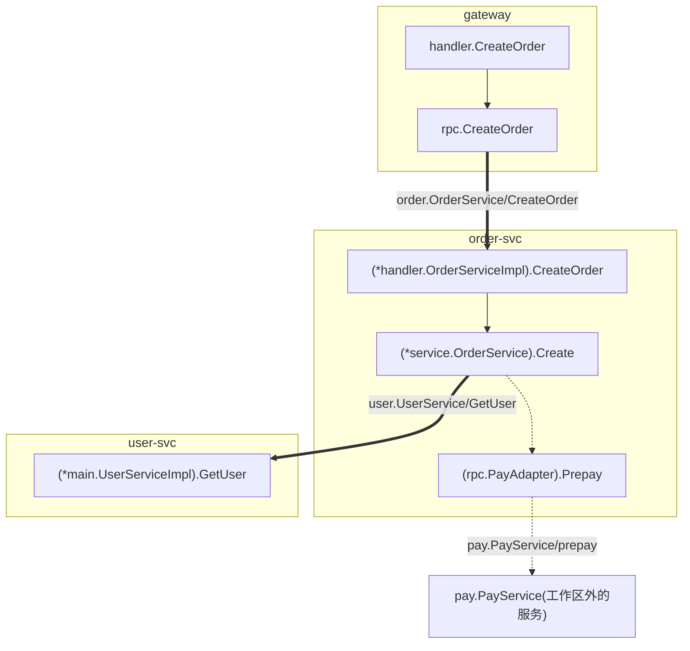

# 示例：演示工作区

基于 [`testdata/demo`](../../testdata/demo) 的输出。工作区有 6 个仓库，场景说明见 [docs/validation.md](../../docs/validation.md#1-演示工作区自动化测试)。

| 文件 | 命令 |
|---|---|
| [scan.txt](scan.txt)、[report.md](report.md) | `kitex-depgraph scan -c testdata/demo/workspace.json` |
| [trace.txt](trace.txt) | `kitex-depgraph trace gateway:CreateOrder` |
| [trace.mmd](trace.mmd) | `kitex-depgraph trace -format mermaid gateway:CreateOrder` |
| [callers.txt](callers.txt) | `kitex-depgraph callers user.UserService/GetUser` |
| [impact.txt](impact.txt) | `kitex-depgraph impact -repo user-svc -diff examples/demo/user-svc.diff` |

`trace.mmd` 渲染出来是这样(按仓库分组，粗箭头是 RPC 调用):

