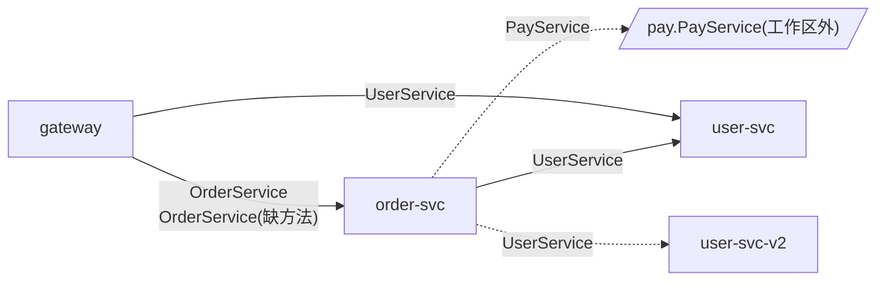

# Kitex 服务依赖报告:demo

> 由 kitex-depgraph 0.1.0 静态分析生成(不编译、不运行)· 扫描时间 2026-10-15T18:35:13+08:00 · 耗时 0.0s

## 概览

| 指标 | 数量 |
|---|---|
| 仓库 | 6(22 个包，32 个 Go 文件) |
| 服务组件 | 4 |
| 服务实现(NewServer / RegisterService) | 3 |
| 组件间 RPC 依赖 | 6 |
| RPC 调用点(已归属到服务组件) | 9 |
| 问题 | 高 1 · 中 2 · 提示 3 |

## 服务依赖图

实线：调用能唯一确定实现方;虚线：工作区外的服务、有多个候选实现方，或实现方缺少被调用的方法。

## 跨服务调用明细

| 调用方 | 被调服务(IDL) | 实现方 | 方法(调用点数) | 匹配方式 | 示例位置 |
|---|---|---|---|---|---|
| gateway | order.OrderService | order-svc | CreateOrder、GetOrder | IDL 身份 | `gateway:rpc/order.go:17` |
| gateway | order.OrderService | order-svc(缺方法) | QueryOrderLegacy | IDL 身份 | `gateway:rpc/order.go:33` |
| gateway | user.UserService | user-svc | GetUser(2) | 共享生成代码 | `gateway:rpc/user.go:14` |
| order-svc | pay.PayService | 工作区外 | prepay | - | `order-svc:rpc/pay.go:22` |
| order-svc | user.UserService | 多个候选:user-svc、user-svc-v2 | GetUser | 共享生成代码 | `order-svc:service/audit.go:14` |
| order-svc | user.UserService | user-svc | BatchGetUser、GetUser | 共享生成代码 | `order-svc:service/order.go:31` |

## 服务实现

| 服务(IDL) | 实现组件 | 实现类型 | 注册名 | 已定位方法 | 注册位置 |
|---|---|---|---|---|---|
| order.OrderService | order-svc | `handler.OrderServiceImpl` | order | 3/3 | `order-svc:main.go:18` |
| user.UserService | user-svc | `main.UserServiceImpl` | user | 2/2 | `user-svc:main.go:12` |
| user.UserService | user-svc-v2 | `main.V2Impl` | user-v2 | 2/2 | `user-svc-v2:main.go:25` |

## 生成代码副本

同一个 IDL 服务可能在多个仓库各生成一份，也可能只在公共 IDL 仓库生成一份。方法集合不一致说明 IDL 不同步。

| 服务(IDL) | 位置 | Kitex 版本 | 编码 | 方法数 |
|---|---|---|---|---|
| order.OrderService | gateway/kitex_gen/order/orderservice | v0.7.2 | Thrift | 3 |
| order.OrderService | order-svc/kitex_gen/order/orderservice | v0.8.0 | Thrift | 3 |
| pay.PayService | idl/kitex_gen/pay/payservice | v0.12.0 | Thrift | 1 |
| user.UserService | idl/kitex_gen/user/userservice | v0.12.0 | Thrift | 2 |

## 问题清单

### 高(1)

- **gateway 调用了 order.OrderService/QueryOrderLegacy,但实现方(order-svc)的生成代码里没有这个方法** `gateway:rpc/order.go:33` 调用方和实现方使用的 IDL 版本不一致：要么实现方还没上线这个方法，要么调用方用了已删除的方法。请对齐两边的 IDL 后重新生成代码。

### 中(2)

- **order-svc 调用的 user.UserService 有 2 个候选实现方:user-svc、user-svc-v2** destService 无法静态确定，或者候选实现方没有可区分的注册名。可在工作区配置里为各实现方填写 serviceNames。
- **order.OrderService 有 2 份生成代码，方法集合不一致(IDL 不同步)** gateway/kitex_gen/order/orderservice(Kitex v0.7.2,3 个方法) 缺少 CancelOrder;order-svc/kitex_gen/order/orderservice(Kitex v0.8.0,3 个方法) 缺少 QueryOrderLegacy

### 提示(3)

- **order-svc 调用 pay.PayService 的 destService 来自运行时** 表达式:cfg.PayService。只按 IDL 身份匹配实现方。
- **order-svc 调用 user.UserService 的 destService 来自运行时** 表达式:svcName。只按 IDL 身份匹配实现方。
- **order-svc 调用了 pay.PayService,工作区里没有它的实现** 涉及方法:prepay。如果实现方在其他仓库，把那个仓库加进工作区即可串起来。

## 读报告须知

- **匹配方式**:`共享生成代码` 表示调用方和实现方引用同一个生成包(公共 IDL 仓库);`IDL 身份` 表示两边各自生成代码，按 `PackageName.ServiceName` 和方法名对齐。
- **组件**:一个仓库通常就是一个组件;一个仓库里有多个 main 包时按 main 包拆分。共享库(SDK、公共模块)里的调用，会归到实际调用它的服务组件上。
- **静态分析的边界**:反射、运行时拼接的方法名或 destService、通过消息队列的异步调用都看不到;接口调用按类层次分析(CHA)展开，可能偏多。
