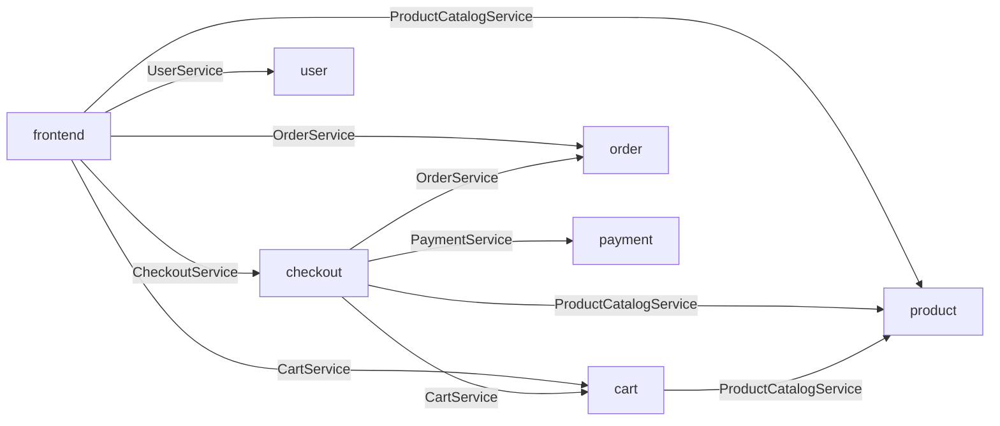

# Kitex 服务依赖报告:gomall

> 由 kitex-depgraph 0.1.0 静态分析生成(不编译、不运行)· 扫描时间 2026-10-15T18:35:13+08:00 · 耗时 0.1s

## 概览

| 指标 | 数量 |
|---|---|
| 仓库 | 10(123 个包，220 个 Go 文件) |
| 服务组件 | 8 |
| 服务实现(NewServer / RegisterService) | 7 |
| 组件间 RPC 依赖 | 10 |
| RPC 调用点(已归属到服务组件) | 22 |
| 问题 | 高 0 · 中 0 · 提示 1 |

## 服务依赖图

实线：调用能唯一确定实现方;虚线：工作区外的服务、有多个候选实现方，或实现方缺少被调用的方法。

## 跨服务调用明细

| 调用方 | 被调服务(IDL) | 实现方 | 方法(调用点数) | 匹配方式 | 示例位置 |
|---|---|---|---|---|---|
| cart | product.ProductCatalogService | product | GetProduct | 共享生成代码 | `cart:biz/service/add_item.go:39` |
| checkout | cart.CartService | cart | EmptyCart、GetCart | 共享生成代码 | `checkout:biz/service/checkout.go:60` |
| checkout | order.OrderService | order | MarkOrderPaid、PlaceOrder | 共享生成代码 | `checkout:biz/service/checkout.go:110` |
| checkout | payment.PaymentService | payment | Charge | 共享生成代码 | `checkout:biz/service/checkout.go:139` |
| checkout | product.ProductCatalogService | product | GetProduct | 共享生成代码 | `checkout:biz/service/checkout.go:75` |
| frontend | cart.CartService | cart | AddItem、GetCart(3) | 共享生成代码 | `frontend:biz/service/add_cart_item.go:38` |
| frontend | checkout.CheckoutService | checkout | Checkout | 共享生成代码 | `frontend:biz/service/checkout_waiting.go:40` |
| frontend | order.OrderService | order | ListOrder | 共享生成代码 | `frontend:biz/service/order_list.go:43` |
| frontend | product.ProductCatalogService | product | GetProduct(4)、ListProducts(2)、SearchProducts | 共享生成代码 | `frontend:biz/service/category.go:37` |
| frontend | user.UserService | user | Login、Register | 共享生成代码 | `frontend:biz/service/login.go:38` |

## 服务实现

| 服务(IDL) | 实现组件 | 实现类型 | 注册名 | 已定位方法 | 注册位置 |
|---|---|---|---|---|---|
| cart.CartService | cart | `main.CartServiceImpl` | - | 3/3 | `cart:main.go:50` |
| checkout.CheckoutService | checkout | `main.CheckoutServiceImpl` | - | 1/1 | `checkout:main.go:50` |
| email.EmailService | email | `main.EmailServiceImpl` | 动态: conf.GetConf().Kitex.Service | 1/1 | `email:main.go:52` |
| order.OrderService | order | `main.OrderServiceImpl` | - | 3/3 | `order:main.go:49` |
| payment.PaymentService | payment | `main.PaymentServiceImpl` | - | 1/1 | `payment:main.go:49` |
| product.ProductCatalogService | product | `main.ProductCatalogServiceImpl` | - | 3/3 | `product:main.go:49` |
| user.UserService | user | `main.UserServiceImpl` | - | 2/2 | `user:main.go:49` |

## 生成代码副本

同一个 IDL 服务可能在多个仓库各生成一份，也可能只在公共 IDL 仓库生成一份。方法集合不一致说明 IDL 不同步。

| 服务(IDL) | 位置 | Kitex 版本 | 编码 | 方法数 |
|---|---|---|---|---|
| cart.CartService | rpc_gen/kitex_gen/cart/cartservice | v0.8.0 | Protobuf | 3 |
| checkout.CheckoutService | rpc_gen/kitex_gen/checkout/checkoutservice | v0.8.0 | Protobuf | 1 |
| email.EmailService | rpc_gen/kitex_gen/email/emailservice | v0.8.0 | Protobuf | 1 |
| order.OrderService | rpc_gen/kitex_gen/order/orderservice | v0.8.0 | Protobuf | 3 |
| payment.PaymentService | rpc_gen/kitex_gen/payment/paymentservice | v0.8.0 | Protobuf | 1 |
| product.ProductCatalogService | rpc_gen/kitex_gen/product/productcatalogservice | v0.8.0 | Protobuf | 3 |
| user.UserService | rpc_gen/kitex_gen/user/userservice | v0.8.0 | Protobuf | 2 |

## 问题清单

### 提示(1)

- **email 提供的 email.EmailService 在工作区内没有调用方** `email:main.go:52` 调用方可能在工作区之外(网关、其他团队的服务)，或者服务已经下线。

## 读报告须知

- **匹配方式**:`共享生成代码` 表示调用方和实现方引用同一个生成包(公共 IDL 仓库);`IDL 身份` 表示两边各自生成代码，按 `PackageName.ServiceName` 和方法名对齐。
- **组件**:一个仓库通常就是一个组件;一个仓库里有多个 main 包时按 main 包拆分。共享库(SDK、公共模块)里的调用，会归到实际调用它的服务组件上。
- **静态分析的边界**:反射、运行时拼接的方法名或 destService、通过消息队列的异步调用都看不到;接口调用按类层次分析(CHA)展开，可能偏多。
